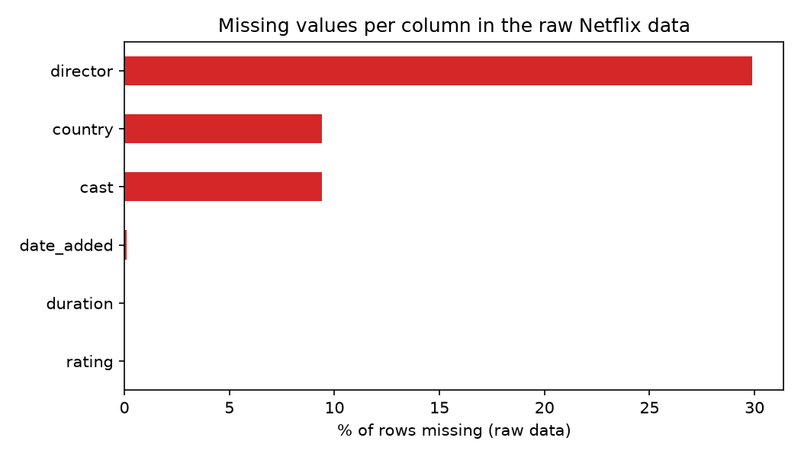

# Data Quality Report: Netflix Titles

**Dataset:** netflix_titles.csv (Kaggle) | **Rows:** 8,807 | **Columns:** 12 raw, 18 after cleaning

## 1. Summary

The raw dataset has no duplicate records and valid values in `type` and `release_year`,
but has missing values in six columns, misplaced values, inconsistent labels, text-stored
dates and multi-value cells. All issues below were handled in `src/clean_data.py`.
Row count is unchanged (8,807) after cleaning.

## 2. Checks that passed

| Check | Result |
|---|---|
| Fully duplicated rows | 0 |
| Duplicate `show_id` | 0 |
| Duplicate title + type + release_year | 0 |
| `type` values | Only Movie (6,131) and TV Show (2,676) |
| `release_year` range | 1925 to 2021, no impossible years |

## 3. Issues found and fixes applied

| # | Issue | Column(s) | Rows affected | Severity | Fix applied |
|---|---|---|---|---|---|
| 1 | Missing values | director | 2,634 (29.9%) | High | Filled with "Unknown" |
| 2 | Missing values | cast | 825 (9.4%) | Medium | Filled with "Unknown" |
| 3 | Missing values | country | 831 (9.4%) | Medium | Filled with "Unknown" |
| 4 | Missing values | date_added | 10 | Low | Left missing (true date unknown) |
| 5 | Missing values | rating | 4 | Low | Left missing |
| 6 | Misplaced value (runtime in `rating`) | rating, duration | 3 | High | Moved to `duration`; `rating` set to missing |
| 7 | Leading/trailing spaces | date_added, title | 88, 1 | Medium | Stripped |
| 8 | Date stored as text | date_added | 8,797 | Medium | Converted to datetime; added `year_added`, `month_added` |
| 9 | Mixed units in one column | duration | 8,807 | Medium | Split into `duration_value` and `duration_unit`; "Seasons" changed to "Season" |
| 10 | Inconsistent labels (NR vs UR) | rating | 3 | Low | "UR" merged into "NR" (NR now 83) |
| 11 | Multiple countries in one cell | country | 1,315 | Medium | Added `primary_country` and `country_count`; original kept |
| 12 | Stray commas in country | country | 7 | Low | Empty pieces ignored when splitting |

## 4. Before and after missing values

| Column | Missing before | Missing after | Filled with "Unknown" |
|---|---|---|---|
| director | 2,634 | 0 | 2,634 |
| cast | 825 | 0 | 825 |
| country | 831 | 0 | 831 |
| date_added | 10 | 10 | 0 |
| rating | 4 | 7 | 0 |
| duration | 3 | 0 | 0 |

## 5. Decisions and limitations

- "Unknown" labels gaps instead of inventing data. Analyses of director, cast or country
  should exclude or separately report "Unknown".
- `rating` has 7 missing after cleaning: 4 originally missing plus 3 blanked misplaced values.
- `primary_country` is only the first country listed, so it does not represent
  co-productions fully. Use `country` for the complete list.
- Row count was not changed: no rows were dropped.